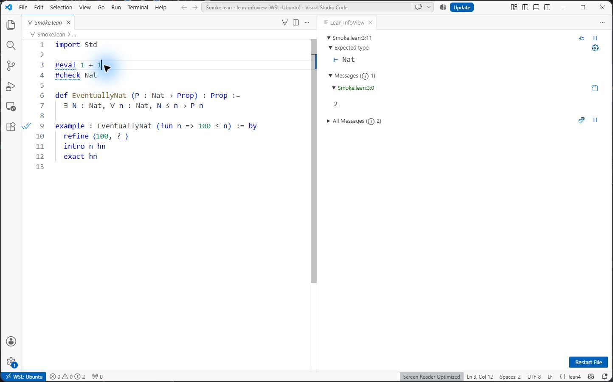
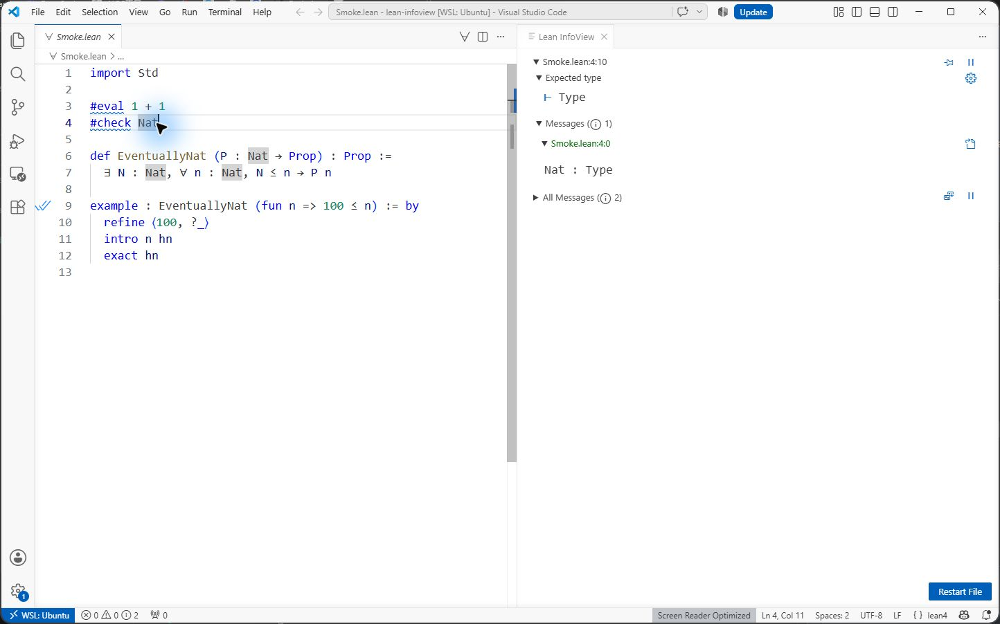
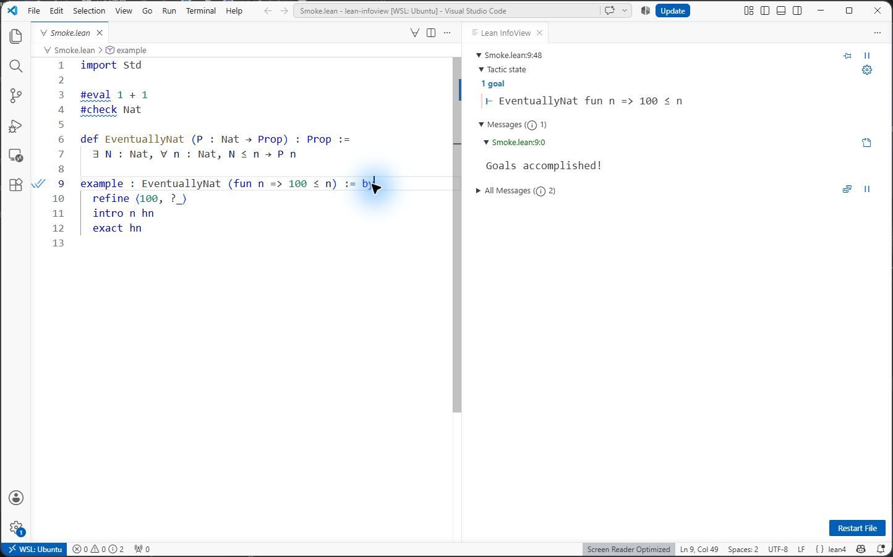
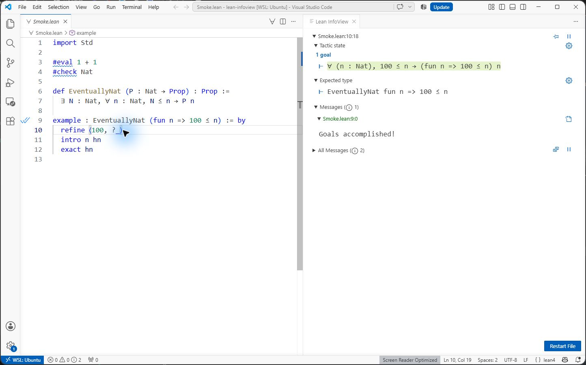
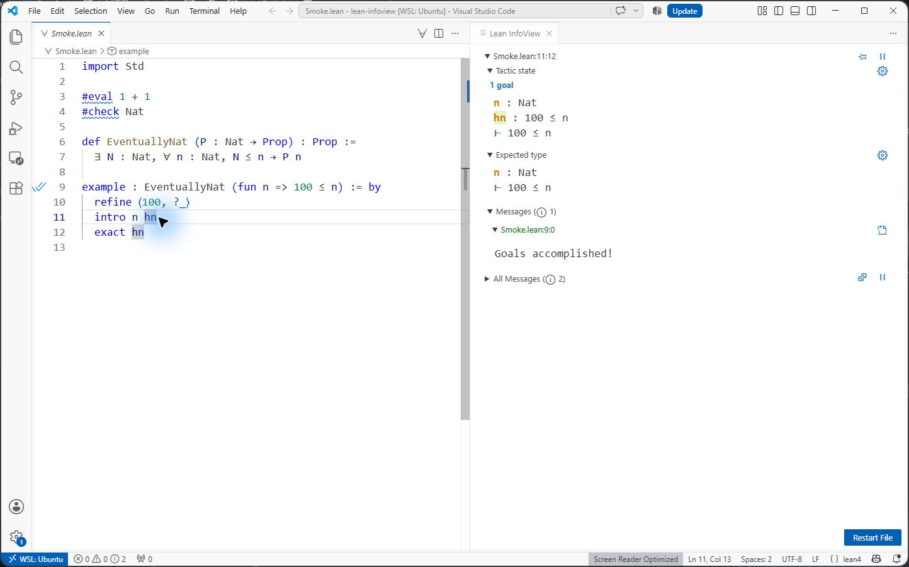
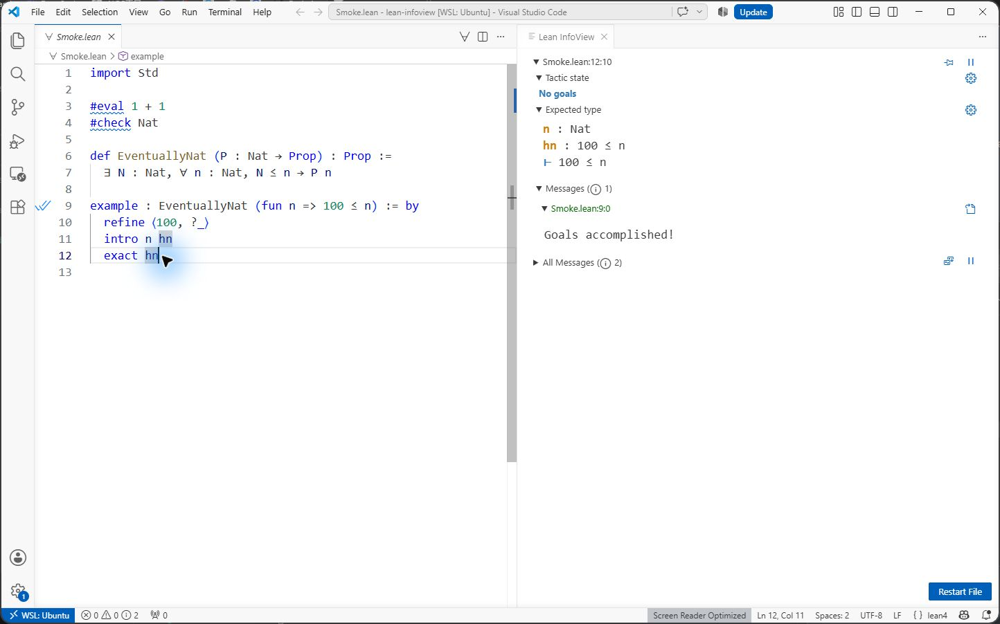

# Lean 源码复制、InfoView 与命令行检查

本说明对应 A.8 的 CalculusBasics/Smoke.lean 单文件练习，先完成编辑器与工具链安装；MathlibSmoke.lean 位于另一个 CalculusLean 项目。用户模块相互导入的操作集中在 A.11，见 [多文件操作](editor-dependencies.md)，不要把这里的独立 Smoke.lean 与 lean/examples/Smoke.lean 混用。

## 从源码复制

本节完整例子在 [examples/Smoke.lean](../lean/AppendixA/Smoke.lean)。用编辑器打开源码复制，保留换行和行首两个空格。PDF 可能把 `by` 和下一行的 `refine` 合并为 `byrefine`，这会成为未知名字。将 `:= by` 保留在声明行，下一行缩进写 refine，intro、exact 同样缩进。不要混入全角空格或 Tab；先修正最前面的语法错误。

## InfoView 查看的是光标位置

VS Code 的 Lean 扩展使用项目工具链启动语言服务器，由服务器载入当前文件所依赖的库并检查代码。InfoView 显示光标所在位置的代码状态；移动光标是在查看检查结果，不是重新逐步执行。把光标放在每条策略行末，等待更新，核对面板的文件与行号。

- import 与 def 行不一定有策略目标，No info found 本身不是错误。
- #eval 的消息为2，表达式期望类型可为 Nat。
- #check 的消息为 Nat : Type。
- by 处目标是 EventuallyNat 命题。
- refine 选见证100后，需证明任意 n 满足100≤n时的结论。
- intro 引入 n : Nat 和 hn : 100 ≤ n，目标为100≤n。
- exact 用 hn 完成目标，Tactic state 显示 No goals。

下面是真实 Windows VS Code / WSL / Lean4.31.0 截图。Messages 可能报告整个声明已完成，不能与 Tactic state 的中间目标混为一谈；Expected type 不是剩余目标。

### 计算结果



### 类型查询



### 初始目标



### 选择见证后



### 引入变量和假设后



### 完成目标后



## lake env lean Smoke.lean 是什么

lake env 准备项目环境；lean 是随后运行的 Lean 编译器程序，Smoke.lean 是输入文件。检查未指定输出参数时，不会自动为这个文件生成 Smoke.olean。

```bash
lake env lean Smoke.lean
```

可选的显式生成练习：

```bash
lake env lean -o Smoke.olean Smoke.lean
```

.olean 是模块导入使用的编译结果，大致对应 Rocq 的 .vo。Lake 管理的工程构建通常把产物放在 .lake/build 下。编辑器检查当前编辑文本，命令行检查已保存文件。这里 InfoView 的“目标”是待证命题；lake build 的“目标”是构建任务，两者不同。完整性另见 [工具链对照](toolchain-comparison.md)。

## +版本报错

+版本由 elan 代理处理。直接运行真实 Lake 或 lake 符号链接指向工具链程序时，会绕过代理。遇到此报错时，先检查实际启动位置：

```bash
type -a lake
ls -l "$HOME/.elan/bin/lake"
command -v elan
```

显式通过 elan 创建数学库项目：

```bash
elan run --install leanprover-community/mathlib4:lean-toolchain lake new CalculusLean math
cd CalculusLean
project_toolchain=$(tr -d '\r\n' < lean-toolchain)
elan run "$project_toolchain" lake exe cache get
elan run "$project_toolchain" lake build
```

--install 可安装缺少的工具链，因此仍需网络和相容依赖；课程应固定已经测试的版本。以上解决的是程序入口，不保证下载成功。已经有同名项目时进入已有目录，不重复 new。

lake build 按配置的目标和依赖构建，并非自动扫描所有独立练习文件。没有被目标包含的 Smoke.lean 仍应显式检查。

## 日常脚本的等待时间与按需导入

A.8 在 CalculusLean 根目录复制 check-lean.sh 一次，随后用 `bash check-lean.sh` 检查 MathlibSmoke.lean。脚本会显示所用版本和文件名；它代为选择版本，不会缩短库载入时间。依赖已备好时，小范围导入可能只需数秒到数十秒，整库导入可能数十秒到数分钟；慢磁盘、其他任务和首次下载或构建会更久。这是参考范围，不是完成时限。暂时没有输出并不等于失败；观察进程活动，出现错误先处理最早的报错，不要反复启动相同检查。

[总入口版本](../lean/AppendixA/MathlibSmoke.lean)使用 import Mathlib；[按需导入版本](../lean/AppendixA/MathlibFocusedSmoke.lean)仅将第一行替换成：

```lean
import Mathlib.Order.Filter.AtTopBot.Defs
import Mathlib.Topology.Defs.Filter
```

其余代码相同。前者包含整套库，后者只载入本例需要的模块及其传递依赖，可以缩小载入范围，但不保证每次都明显加快；两个版本都可用于安装核验。模块名应以项目实际 mathlib 版本为准，缩小导入后重新检查全部代码，不必为此重装库。

在 CalculusLean 根目录，附件与项目并列且脚本已复制时执行：

```bash
cp -i ../code/lean/AppendixA/MathlibFocusedSmoke.lean .
bash check-lean.sh MathlibFocusedSmoke.lean
```

## 正常终端输出

MathlibSmoke.lean 的四条 #check 对应[完整输出示例](outputs/MathlibSmoke.txt)，只供核对，不输入终端。末尾 example 检查通过通常没有额外文字；没有错误还须检查警告及退出状态。类型层次参数的编号可能随版本变化。

关闭文件或窗口后，检查进程可能结束，再次打开需要重新载入库和建立状态；预编译文件不会保存上一进程的全部内存状态，因此第二次打开也可能较慢。

## 何时省去 elan run

直接 lake 已选中项目要求的工具链时，日常可用 `lake env lean MathlibSmoke.lean` 和 `lake build`；需要补齐缓存才用 `lake exe cache get`。入口版本不符、受覆盖影响或需要显式控制时，使用 elan run 或脚本。首次核对方法、适用条件及完整命令见 [Lake 两种写法](lake-command-forms.md)。赋值与后面的命令必须分行，不能连成 `lean-toolchain)elan run`。
